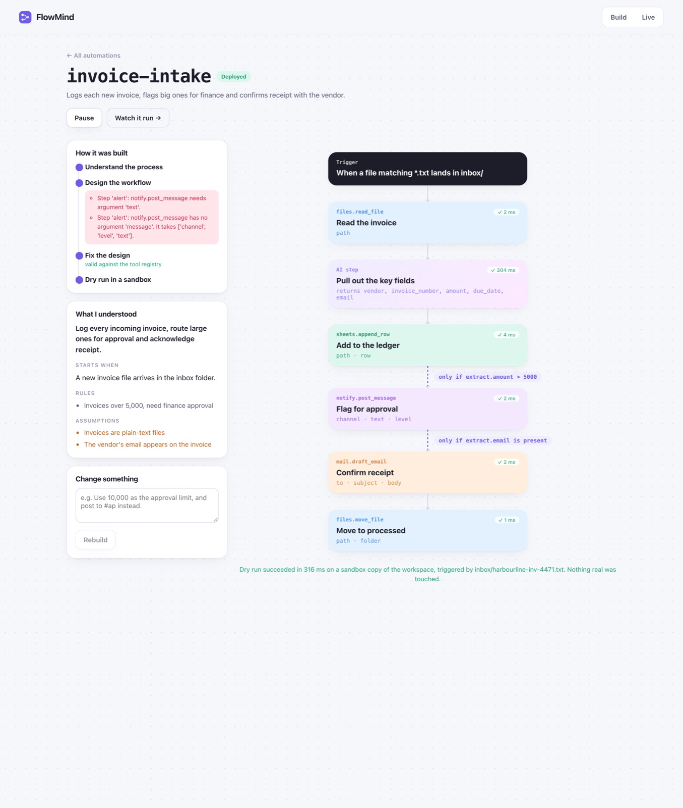
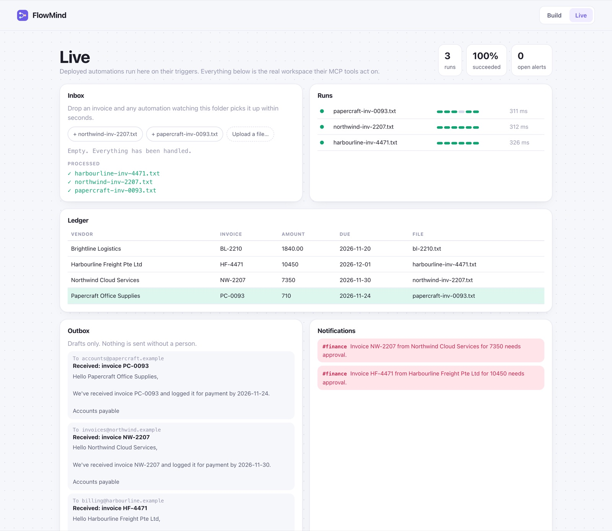
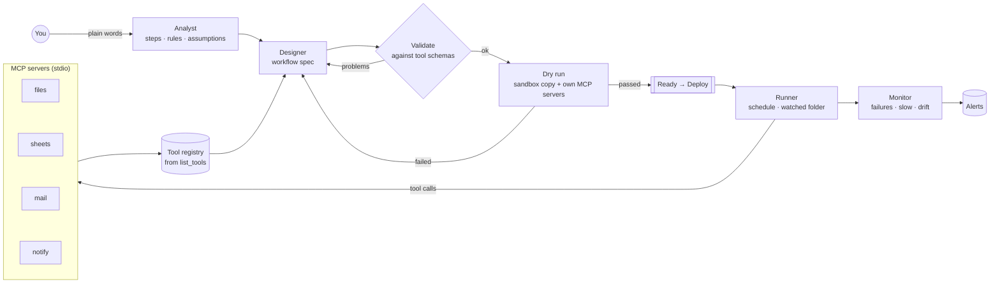

# FlowMind

**Describe the process. Get the automation.**

Explain a business process the way you would tell a colleague: *"When a new invoice lands in the inbox, log it to the ledger, alert finance if it's over 5,000, email the vendor to confirm we got it, and file it away."*

FlowMind then:
- analyses the process into steps, rules and assumptions
- designs a workflow over real **MCP** tools
- validates it against the tools' own schemas
- dry-runs it in a sandbox copy of the workspace
- fixes whatever broke
- once you deploy it, runs it on its trigger and monitors every run



## What it shows

| | |
|---|---|
| **Real MCP** | Four bundled MCP servers (files, sheets, mail, notify) built on the official Python SDK. FlowMind connects over stdio, builds the tool registry from their live schemas and annotations, and calls them for every step |
| **Analyst → designer → validate → dry run, with a fix loop** | A LangGraph cycle. Validation errors and dry-run failures go back to the designer as concrete problems ("notify.post_message has no argument 'message'. It takes ['channel', 'level', 'text']") until the workflow is clean, up to a bounded number of fixes |
| **Sandboxed dry runs** | A dry run gets its own MCP servers pointed at a throwaway copy of the workspace, so it exercises every real tool without touching real data |
| **A small workflow language** | Tool steps and AI steps, wired with `{{templates}}`. AI steps declare typed output fields, which become a schema for Claude's structured output. Business rules are `when` conditions on the steps they gate |
| **Runner and monitor** | Deployed workflows fire on a schedule or when a file lands in a watched folder, and each file is handled exactly once. Every run is traced step by step and checked for failures, slow runs, and extraction drift against the dry-run baseline |
| **Safe by construction** | Every tool path is confined to the workspace. Mail is drafted to an outbox, never sent. Tools carry MCP read-only and destructive annotations. Nothing deploys until it has passed a dry run |



## Architecture



Each Lab product uses a different orchestration:

| Product | Orchestration |
|---|---|
| [Ashariri](https://github.com/balajisriraj/ashariri) | A routed state machine |
| [PaperSensei](https://github.com/balajisriraj/paper-sensei) | A parallel map-reduce |
| [VibeLens](https://github.com/balajisriraj/vibelens) | A tool-using agent |
| [SkillSmith](https://github.com/balajisriraj/skillsmith) | An evaluator-optimizer |
| FlowMind | A plan-then-execute system: the model designs a program once, deterministic code runs it every time, and the model's judgement is used only inside AI steps |

More in [docs/architecture.md](docs/architecture.md).

## Run it

```bash
cd backend
uv sync
FLOWMIND_LLM=scripted FLOWMIND_SCRIPTED_DELAY=0.03 uv run flowmind serve   # API, runner and MCP servers on :8000
cd ../frontend && pnpm install && pnpm dev                                # UI on :5173
```

With Claude: `export ANTHROPIC_API_KEY=sk-ant-...`, then `uv run flowmind serve`. With Docker: `cp .env.example .env && docker compose up --build`, then open http://localhost:8080.

From the terminal: `uv run flowmind build "Every minute, post overdue tasks from the tracker to the team channel."`

## Tests and evals

```bash
cd backend && uv run pytest   # templates and validation, MCP path confinement, monitor rules, sandboxing, exactly-once file handling
uv run flowmind eval          # describe → build → deploy → trigger, end to end
```

```
PASS  Invoice intake: ready after 1 fix(es); validation rounds [2, 0]; dry run succeeded (6/6 steps ok)
      live: 3 run(s) fired, 3 succeeded
PASS  Overdue digest: ready after 1 fix(es); validation rounds [2, 0]; dry run succeeded (3/3 steps ok)
      live: 1 run(s) fired, 1 succeeded
Workspace: 4 ledger rows, 3 drafts in the outbox, 3 notifications, 0 files left in the inbox
```

The tests also cover:
- a designer that never produces a valid workflow: the build stops after the allowed fixes and deploy is refused
- a ledger that changes shape under a deployed workflow: the run fails and raises an alert
- a dry run, which must leave the real ledger and inbox untouched

## Layout

```
backend/flowmind/
  servers/      files.py · sheets.py · mail.py · notify.py   (MCP servers; paths confined to the workspace)
  hub.py        MCP stdio client sessions + the tool registry
  spec.py       workflow language: steps, templates, conditions, static validation
  builder.py    LangGraph: analyse → design → validate → dry run, with the fix loop
  engine.py     executes a workflow and records a step-level trace
  service.py    build jobs, runner (schedules, watched folders), workspace view
  monitor.py    failure, slow-run and drift checks
frontend/src/   Home (describe + registry) · BuildView (timeline + canvas) · Monitor (live workspace)
```

---

Part of [the Lab](https://balajisriraj.com/#lab), ten agentic products by [Balaji Sri Raj](https://balajisriraj.com).
